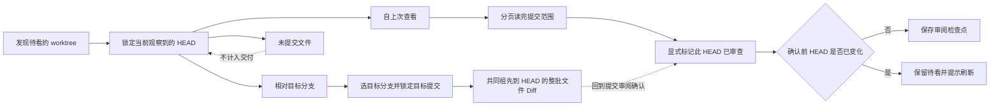

# Kivo Git 0.6.5：Agent 交付审阅路线图

目标：AI 在另一个 worktree 改完代码，我不切分支，就能看懂整批改动、核对文件差异，并确认自己审到了哪个提交。基线是 [0.6.4 候选版的工作树审阅](./AGENTIC_REVIEW_SPEC.md)。

## 拆分

| 顺序 | 任务 | 完成标准 |
| --- | --- | --- |
| 0 | 0.6.4 真实仓库验收 | 用外部 AI 开工作树、连续提交、改写历史、移除工作树；确认待看状态和固定提交的 Diff，不自动发布。 |
| P0.1 | 提交分页 | 首屏快速可读；「加载更多」只追加同一 HEAD 与同一检查点下的提交。加载失败可重试；还有下一页时不允许将整段历史标为已审查。 |
| P0.2 | 整批交付比较 | 显式选择本地分支或远程跟踪分支；显示目标提交、共同祖先和被审阅 HEAD。列出从共同祖先到 HEAD 的新增、修改、删除、重命名。点击文件打开原生 Diff。 |
| P0.3 | 并发与回归 | 比较期间移动目标分支，现有 Diff 仍使用锁定的快照；切换工作树、选择另一个目标或关闭审阅时，旧请求不覆盖新 UI。已有待看、History 和提交草稿不被覆盖。 |
| P1 | 未提交状态感知 | 先做可见工作树的低频、有上限的脏状态读取；点开才读文件。未知不能显示为干净，不把它算入已交付提交。 |
| P2 | 带范围反馈给 AI | 明确选择要复制的分支、起止提交、文件及用户备注。复制到本地剪贴板，不自动发送，不依赖特定 Agent。 |

## 比较口径

- **自上次查看**：以记录的 HEAD 为检查点。没有检查点就标成最近历史；检查点不可达则区分历史改写或旧基准不可用，不能把回退结果标作新增。
- **相对目标分支**：交付 Diff 为唯一共同祖先 → 被审阅 HEAD，不是直接比较两个分支 tip，也不是检查点之后的新提交。远程跟踪引用是本机已知状态；不会为了对比而自动 fetch。无共同祖先或存在多个最佳共同祖先时提示不可比较，不猜基准。
- **未提交文件**：与以上两个范围分开。查看不改工作树、不切换分支、不自动提交、推送、合并或清理。

## P0 验收样例

1. 一个 worktree 有超过两页的新增提交，同时目标分支也有独立修改。分页要覆盖完整范围且不重复；整批 Diff 中不应把目标分支独有修改算作交付。
2. 交付包含重命名、删除和新增：逐项打开 Diff，左右侧必须来自当次锁定的 Git 对象；不能只显示当前磁盘文件。
3. 审阅时让 agent 继续提交，或移动目标分支。旧预览仍可读；确认新 HEAD 时必须重新审阅，不能悄悄推进检查点。
4. 窄栏和键盘可切换审阅范围、分页、打开文件 Diff 和返回 History。待看、提交标题预览及未提交文件仍可用。
