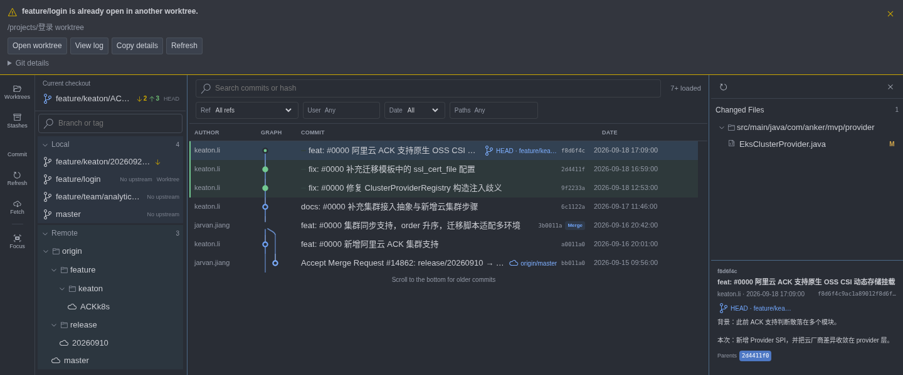
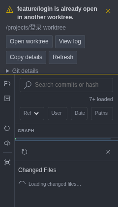
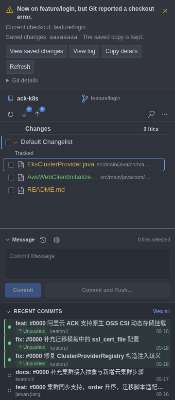

# Checkout 与 worktree 可靠性

2026-10-26：本轮范围为分支切换、失败恢复与已有 worktree 的识别和打开。

- 切换前检查分支、跟踪关系、未完成操作和 worktree 占用；任何已知占用都在创建 stash 之前拒绝。用户确认之后、写入之前再次检查，仍处理外部进程造成的竞争。
- 当前与其他 worktree 使用中的分支有明确标记；允许选择已登记的 worktree 在新窗口打开。打开前重新读取 Git 登记并验证目录。独立工作目录的 index、冲突及 changelist 状态保持隔离。
- 分支切换、创建并切换、detached checkout 在结束后读取真实 HEAD。命令非零但已经到达目标时明确说明“目标已到达，Git 仍报告错误”；不引导重复切换。
- 失败在当前工作目录关联的面板卡片中保留，普通刷新和其他提示不清除。面板重建从宿主重新获取。允许显式关闭、查看日志、复制详情、刷新，以及与问题有关的恢复入口。面板不可见时使用 VS Code 通知兜底。
- stash-and-switch 后失败时，记录精确 stash OID，允许查看本次保存的内容。恢复使用已有带校验的 apply 流程，保留 stash 副本。
- 不增加强制切换、自动丢弃改动、自动删除锁文件或 worktree 清理。新建/删除 worktree 后续单独设计。

验收：真实 Git 验证正常/被占用切换、暂存前拦截、linked worktree 对称识别、远程跟踪分支占用、hook 部分成功、未完成操作、stash 恢复信息、中文/空格路径。界面验证错误保留与根目录隔离、恢复动作、窄面板与键盘入口；宿主验证路径重新授权与不可见错误兜底。

## 0.5.7 验证记录

- 类型与 JavaScript 语法检查通过。
- 25 个测试文件、186 项单元和真实 Git 回归通过，其中本轮新增 20 项。
- 完整 Webview E2E 通过，包含既有提交/历史/搜索/Cherry-pick 场景和本轮错误保留、旧回复隔离、worktree 入口、窄面板及精确 stash 查看。
- 本地生产编译、VSIX 打包与运行资源清单校验通过。
- GitHub 现有 CI / Release VSIX 流程会继续执行 Linux VS Code Extension Development Host 冒烟及打包检查，具体状态以本次提交的 Actions 结果为准。

截图来自真实生产 Webview 代码和固定测试数据，原生 Git 行为由隔离仓库测试单独验证。错误卡片保留在当前扩展宿主会话中，关闭再打开面板可恢复；完整重启 VS Code 会重新读取 Git 状态，新的命令失败会生成新的诊断。Windows/macOS 文件占用、系统权限及真实用户 hook 的行为还需对应平台验收。

