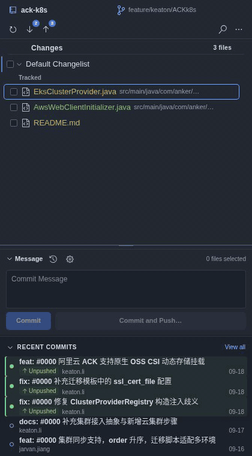

# Kivo Git 交互动效

[原始操作录屏（WebM）](images/motion-0.5.8/preview.webm)

录屏使用生产 Webview 代码和固定测试数据，模拟 Git 等待、真实状态回传和错误恢复；未操作用户仓库。GIF 为 16fps，原始录屏保留浏览器捕获的帧率。

本轮以现有 Commit / History 布局为基准，动效用于解释操作状态。文件内容、分支操作与恢复规则继续由 Git 结果决定。

| 场景 | 表现 | 时间 |
| --- | --- | --- |
| 菜单、分支选择、审阅弹窗 | 轻微上移淡入，焦点立即可用；选择后立即执行动作 | 140ms |
| 错误恢复卡片 | 新问题出现时淡入；同一问题刷新时保持静止；关闭后立即退出键盘路径，再淡出 | 160 / 100ms |
| 分支切换等待 | 超过 120ms 才显示等待标记与文字，避免快速操作闪烁；保持原分支名直到真实状态更新 | 120ms 阈值 |
| 当前分支改变 | 仅对分支标题做一次轻微淡入，文件列表与滚动位置保持稳定 | 180ms |
| 操作提示 | 短距离淡入/淡出，关闭即释放交互 | 120 / 100ms |
| 按钮 | 轻量颜色和透明度反馈，不改变命中区域 | 80–140ms |

使用现有 Webview 的 Web Animations API 和共享时长令牌，不引入新的 UI 框架。静态布局继续遵从 IDEA/VS Code 宿主规范。本轮用户明确要求交互动画，允许上述局部状态过渡；原有禁止装饰动画、计数器跳动和整表重播的边界继续适用。

减少动态效果时跳过位移动画和等待扫光，文字与操作状态保留。视图隐藏时取消运行中的动画；仅在过渡播放期间补充逐帧偏好检查，避免嵌入式浏览器延迟送达系统偏好事件；新状态到来时取消重叠动画。动画不延迟 Git 命令，不制造百分比，也不把 hook 部分失败显示为完整成功。

## 验证

188 项单元与真实 Git 回归保持通过；完整 Webview E2E 覆盖原有功能与动效回归，包括打开菜单、背景不透明、焦点恢复、不重播错误、退出被新错误打断、减少动态效果取消、快/慢切换反馈和当前分支更新。动效由本地 Chromium 验证；原生 VS Code 宿主检查继续由仓库的 CI / Release 流程执行。录屏和自动化不能代表所有系统缩放、显示器刷新率或设备上的主观流畅度。
